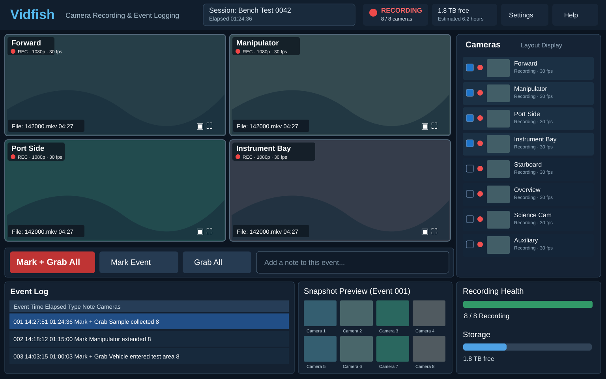

# Vidfish

Rust desktop software for scientific camera acquisition on Windows and Linux.
The foundation provides an egui desktop, persistent typed settings, structured
logging, an independently testable Tokio lifecycle, and GStreamer RTSP recording/
preview. Epic #2 adds ONVIF discovery, persistent camera identities/aliases, app-managed local
credentials, and independent camera polling/reconnection. Arriving cameras can auto-record in independent processes with observable file progress.
Segmentation, disk-space policies, events, and session management remain later work.

## Target operator UI



[Open full-size target layout](docs/target-ui.svg) · [UI epic #4](https://github.com/Matjordan/vidfish/issues/4)

This layout is the **reference design**, not a screenshot of implemented functionality. It is intended for an attended Toughpad in scientific bench or vehicle testing. Prioritize recording confidence and usable touch targets over visual fidelity where they conflict.

- Four large live previews in a 2×2 grid, with single-camera fullscreen and quick camera swaps.
- Right-hand camera roster showing all discovered cameras, independent recording state, aliases, and current preview selection (up to 16 recording, up to 4 displayed).
- Top strip showing session, elapsed time, recording counts, and disk capacity.
- Large **Mark + Grab All**, **Mark Event**, and **Grab All** controls with keyboard shortcuts; optional notes.
- Collapsible event log and associated snapshot previews below the camera feeds. Show recording filenames and precise per-camera offsets in event detail.
- Clear camera-specific failures, missing-camera indicators, reconnect status, and actual file-write health; never equate live preview with successful recording.
- Responsive for Toughpad resolution and touchscreen interaction. The bottom panel and sidebar may collapse to preserve preview area.
- Display changes, snapshots, notes, and browsing must not interrupt ongoing recordings.

**Visual source:** The SVG is a checked-in, maintainable layout reference based on the proposed dark Vidfish UI. It uses illustrative camera placeholders, not operational camera imagery. The UI does not need to replicate ornamental styling pixel-for-pixel.

## Development

Install rustup and the GStreamer development/runtime prerequisites in
[docs/media.md](docs/media.md). `rust-toolchain.toml` pins Rust 1.99.0.

```sh
cargo run --locked -p vidfish
cargo test --locked --workspace --all-features
cargo clippy --locked --workspace --all-targets --all-features -- -D warnings
cargo fmt --all --check
```

## Prototype workflows

```sh
cargo run --locked -p vidfish -- --media-check
cargo run --locked -p vidfish -- --demo --desktop-seconds 10
cargo run --locked -p vidfish -- --preview rtsp://CAMERA/PROFILE
cargo run --locked -p vidfish -- --record rtsp://CAMERA/PROFILE --output NEW_FILE.mkv
cargo run --locked -p vidfish -- --inspect NEW_FILE.mkv
cargo run --locked -p vidfish -- --check
cargo run --locked -p vidfish -- --service
cargo run --locked -p vidfish -- --discover --interface LOCAL_IPV4
cargo run --locked -p vidfish -- cameras list
```

Repeat `--preview` up to four times; add `--h265` for an H.265 profile. Recording
runs in a separate process and survives preview window closure/restart. Ctrl+C
finalizes the recording. The desktop and service discover/poll cameras when an adapter
is configured. Use View feed in the camera list to open a preview. Auto-record is on
by default for registered/arriving cameras; Record all, Stop all, and per-camera controls
operate independent recorder processes. A desktop restart reattaches to active recordings.
Use either the desktop or headless service as the camera manager for an inventory. See [media setup](docs/media.md)
and [camera discovery, credentials, and lifecycle](docs/cameras.md).

For a simulated 1080p camera with ONVIF endpoints:

```sh
cargo run --locked -p vidfish-media --example camera-fixture --features fixtures
```

Fixtures bind only loopback. They exercise RTSP stream-copy, preview restarts,
H.264/H.265 media inspection, ONVIF SOAP/WS-Discovery, and snapshots. Process smoke
tests verify recording remains usable after a preview process is killed.

## Settings

Settings use the platform configuration directory (`directories::ProjectDirs`),
or `--config PATH`. A missing file uses defaults without writing anything. Save
settings in the desktop to persist them. Writes run off the UI thread and use a
synced temporary file followed by atomic replacement. Invalid/future settings fail
visibly. Changes take effect on the next manager start.

```json
{
  "schema_version": 1,
  "output_directory": "recordings",
  "auto_record": true,
  "segment_seconds": 600,
  "stall_seconds": 30,
  "disk_warning_bytes": 1073741824,
  "disk_stop_bytes": 268435456,
  "disk_policy": "Stop",
  "max_cameras": 16,
  "preview_slots": 4,
  "camera_interface": null
}
```

Relative paths use the launch working directory. Auto-record changes persist immediately
and affect future starts; turning it off leaves active recordings running. Stop all
suppresses automatic restarts until Record all or an application restart. Recordings
use keyframe-aligned MKV segments (600 seconds by default), durable boundary indexes,
disk warning/stop policy, and gap history. See [continuous recording](docs/recording.md).
The prototype refuses existing output files and never deletes scientific data.
JSON structured logs go to stdout; `RUST_LOG=debug` increases detail. Settings have
no credential fields. Raw GStreamer error/debug strings are excluded from errors
because camera URIs can contain credentials.

## Branches, CI, and releases

[AGENTS.md](AGENTS.md) records the per-epic branches/PRs and commit rules. Each
verified coherent change is committed on its epic branch. Planning PRs remain drafts.

CI and release workflows share build, lint, tests, RTSP smoke, desktop launch checks,
and package steps. Draft PR updates run Linux only; marking a PR ready for review
runs both Windows and Linux, as do later updates to ready PRs. Manual CI runs and
releases always check both platforms. PR CI uploads executable packages. Every
push to `main`, including PR merges, publishes only after both platform packages pass.
Version `0.1.<release workflow run number>` appears in `--version`, Git tags, and
archive names. Failed runs may leave gaps; reruns retain their version and do not
replace an existing release. PR packages use `0.1.0-ci.<CI run number>`. The Cargo
manifest remains at development version `0.1.0`; update the release version prefix
to start a new major/minor series.

GitHub Releases include a Windows ZIP with GStreamer runtime, a Linux tarball with
runtime installation instructions, and SHA-256 checksums. No Rust installation is
needed to launch packages. See [deployment instructions](docs/media.md). Publishing
needs Actions enabled; its token has write access only in the publication job.

## Epic sequence and outstanding acceptance

1. #7: workspace, settings, desktop/manager lifecycle.
2. #8: GStreamer recording/preview spike and four-preview Toughpad measurements.
3. #9: Windows/Linux delivery, runtime packaging, and simulated camera fixtures.
4. #10–12: discovery, stable identities, and reconnection.
5. #13–16: isolated multi-camera recording, segments, controls, and health.
6. #17–19: operator preview controls and resource limits.
7. #20–25: event capture, sessions, browsing, retention, and export.

The operator reported successful four-stream operation after merging the foundation.
Cloud virtual-display checks establish functionality, not target hardware performance.
Epic #1/#8 remain incomplete until actual Toughpad CPU/GPU measurements and required
Windows/Linux acceptance evidence are recorded. Do not claim zero-copy preview upload,
frame-perfect synchronization, or sustained 16-camera acquisition from this spike.
