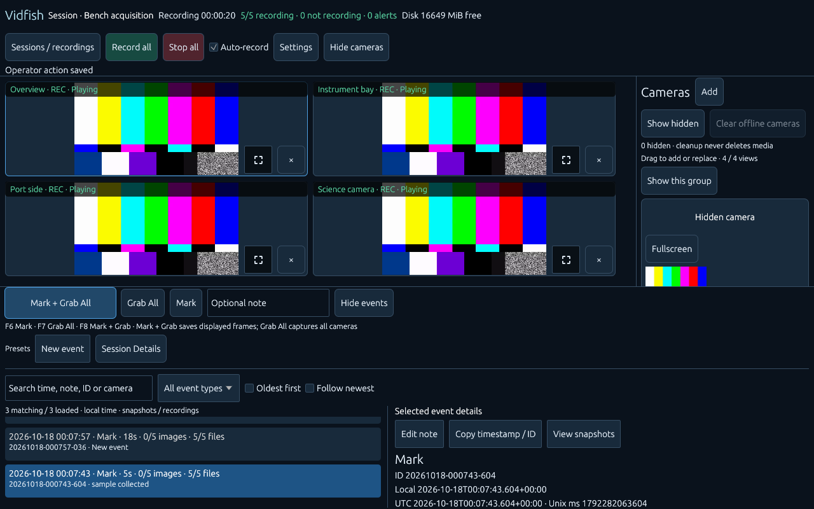
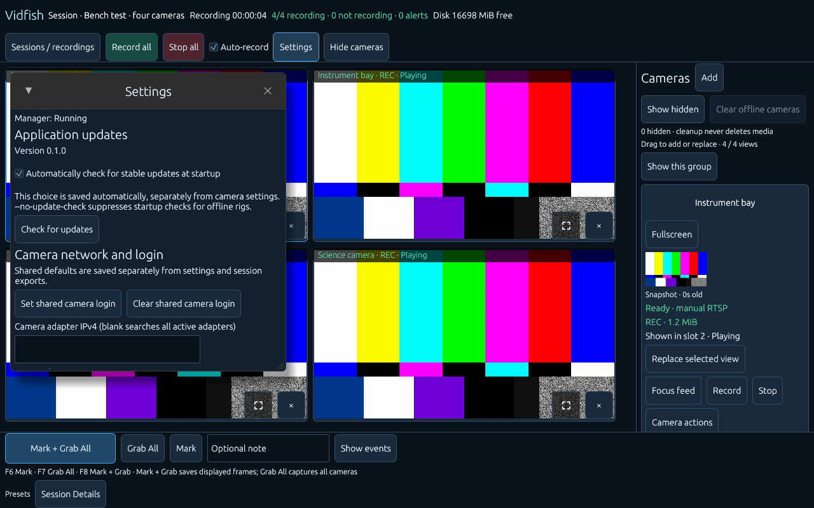

# Vidfish

Rust desktop software for scientific camera acquisition on Windows and Linux.
Discover ONVIF cameras, record H.264/H.265 RTSP video, monitor live feeds, and
collect timestamped events and images in named acquisition sessions.



Actual Linux desktop screenshot at 1280×800, using four displayed simulated feeds
and a fifth recording camera outside the grid.
The camera test patterns are fixtures, not footage from a deployment.

## Install

Download a versioned package from [GitHub Releases](https://github.com/Matjordan/vidfish/releases).
No Rust installation is needed to run a release.

- **Windows 10/11 x86_64:** run `vidfish-VERSION-windows-x86_64-setup.exe`.
  The per-user installer includes the GStreamer runtime and creates Start Menu
  and uninstall entries. A portable Windows ZIP is also available.
- **Linux x86_64:** install the system media dependencies, extract
  `vidfish-VERSION-linux-x86_64.tar.gz`, and run `./install.sh`.
  Use `./launch-vidfish.sh` for portable operation.

Release assets include SHA-256 checksums. Vidfish Windows executables and installers
are currently unsigned. See [installation, updates, rollback and uninstall](docs/installing.md)
for dependencies, verification and data locations.

PR test builds are available as Windows and Linux artifacts on the
[Actions page](https://github.com/Matjordan/vidfish/actions). They require a GitHub
login and contain development changes that may not yet be in a stable release.

## Start an acquisition

1. Open **Settings** and choose an absolute output directory on a disk with enough
   free space. Set a session name and check the recording/segmentation settings.
2. Allow automatic ONVIF discovery across active IPv4 adapters, or add a camera
   manually. Configure a shared camera login or individual camera credentials.
3. Choose which feeds to display. Drag cameras into the workspace; up to eight previews can be shown, with
   single-camera fullscreen; the camera roster supports up to 16 recording cameras.
4. Use **Record all**, **Stop all**, or individual camera controls. Auto-record is
   enabled by default; arriving registered cameras can start recording automatically.
5. Add optional notes and use the event controls below. Open **Sessions / recordings**
   to browse acquisitions, recording segments and events or export a portable bundle.
   Use the native **Browse…** controls to select output and export folders.

Recording runs in independent processes. Closing or restarting the viewer does
not stop an acquisition; a reopened desktop reattaches to active recorders. Stop
recordings explicitly when finished. **Stop all** suppresses automatic restarts
until **Record all** or an application restart.

### Events and images

| Action | Shortcut | Result |
| --- | --- | --- |
| Mark | F6 | Save a timestamped event and optional note without images. |
| Grab All | F7 | Request fresh stills from all registered cameras, including hidden feeds. |
| Mark + Grab All | F8 | Save an event with the frames currently displayed in the viewer. |

**Mark + Grab** saves the displayed pixels as they were at the action, without an
ONVIF snapshot or another camera connection. A frozen displayed frame is retained
with its original local receipt timestamp; cameras without a displayed frame are
reported as uncaptured. **Grab All** is a separate fresh-camera capture operation.

The resizable event list supports search, sorting, persistent non-image details,
clipboard actions and separate snapshot viewing. Configure quick event labels in
**Session Details**; presets are saved per session and create ordinary Mark events.
New session/event IDs use UTC date/time with collision suffixes; legacy UUID data
remains readable. The UI shows local timestamps with offsets.

Events retain stable camera IDs, recording references, notes and PNG images with
JSON/CSV metadata. Captures and recording offsets have explicit timing uncertainty;
they do not establish synchronized camera exposure times. See [events and captures](docs/events.md)
and [sessions, browsing, export and retention](docs/sessions.md).

### Recording and network behavior

While recording, each recorder owns one RTSP connection to its camera. Viewers
and RTSP still captures consume its bounded local encoded feed, avoiding duplicate
camera streams on a throughput-limited network. Closing or slowing a viewer does
not block the recorder. Recordings copy encoded video without re-encoding.

A brief input interruption keeps the existing recording writer and file open while
the reader reconnects. Recovery within the **two-second video-loss grace period**
continues the same run/file; longer continuous loss triggers recovery in a new run.
Normal timed segment rotation still applies. Missing footage is not synthesized.

Keyframe-aligned MKV segments, durable boundary indexes, recovery/gap logs, and disk
warning/stop policies make recording progress observable. A playing preview alone
is not evidence that a file is growing. See [recording and recovery](docs/recording.md)
and [operator monitoring](docs/monitoring.md).

### Settings and camera management



Settings include output/session configuration, preview and recording limits,
segmentation, disk policy, discovery and shared camera login. Camera controls support
aliases, per-camera login, hiding/restoring roster entries and guarded inventory
cleanup. Hiding a camera does not stop recording or delete scientific data.

Camera thumbnails refresh at a configurable five-second target, including feeds
outside the grid, with explicit age/stale indicators and a single capture worker.

Configuration uses the platform configuration directory, or `--config PATH`.
Camera credentials currently use an app-managed local plaintext file for the closed
system deployment; settings and session metadata contain no passwords. See
[cameras and credentials](docs/cameras.md) for details.

Updates can be checked from Settings. Recording-safe updates defer installation
until acquisition has stopped. Install/uninstall preserves settings and scientific
data; retention is a separate, explicit operation. Close old desktops/services and
finish recordings before manually replacing an installation.

## Development

Install rustup and the GStreamer development/runtime prerequisites in
[media setup](docs/media.md). `rust-toolchain.toml` pins Rust 1.99.0.

```sh
cargo run --locked -p vidfish
cargo test --locked --workspace --all-features
cargo clippy --locked --workspace --all-targets --all-features -- -D warnings
cargo fmt --all --check
```

Useful CLI workflows:

```sh
cargo run --locked -p vidfish -- --media-check
cargo run --locked -p vidfish -- --demo --desktop-seconds 10
cargo run --locked -p vidfish -- --preview rtsp://CAMERA/PROFILE
cargo run --locked -p vidfish -- --record rtsp://CAMERA/PROFILE --output NEW_FILE.mkv
cargo run --locked -p vidfish -- --inspect NEW_FILE.mkv
cargo run --locked -p vidfish -- --check
cargo run --locked -p vidfish -- --service
cargo run --locked -p vidfish -- cameras list
cargo run --locked -p vidfish-media --example camera-fixture --features fixtures
```

Repeat `--preview` up to eight times; add `--h265` for H.265. Ctrl+C finalizes a
CLI recording. Use either the desktop or headless service as the camera manager
for an inventory. Fixtures bind loopback and provide simulated RTSP/ONVIF cameras.
Optional native smoke scripts live in `scripts/`.

Settings writes use synced temporary files and atomic replacement. Relative output
paths use the launch working directory. Structured JSON logs go to stdout;
`RUST_LOG=debug` increases detail. Raw media error strings containing camera URLs
are excluded from operator errors.

## Builds and releases

PR and manual CI **build and package Windows and Linux executables, runtime bundles
and installers**. GitHub does not run tests, lint, native smoke or package-launch
checks. Relevant checks run locally during development; Windows runtime tests remain
paused at the operator's request.

Every push to `main`, including a merged PR, builds both platforms and publishes a
release after both packages succeed. Versions use `0.1.<release workflow run number>`
for the application, tag and assets. PR packages use `0.1.0-ci.<CI run number>`.
Failed release runs can leave version gaps; reruns retain their version and do not
replace an existing release. See [AGENTS.md](AGENTS.md) for branch and commit rules.

Physical-camera recovery and sustained throughput still require testing on the target
network/hardware. The operator reported successful four-stream use; numerical
Toughpad CPU/GPU measurements are deferred. Linux fixture checks do not establish
Windows runtime behavior, synchronized capture or sustained 16-camera performance.
